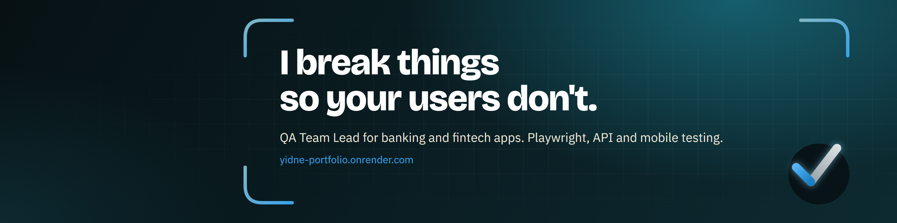
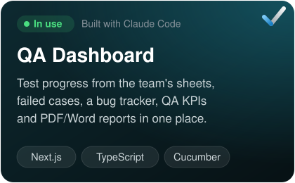
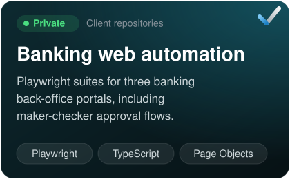
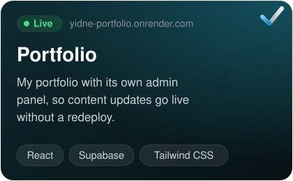

## Hi, I'm Yidne

QA Team Lead at **EagleLion System Technology** in Addis Ababa. I lead a 17-person QA team testing a pre-launch mobile super app for one of Ethiopia's largest banks, and I build the tools and automation that keep releases calm.

### My career, as a test run

### Recent work

<table>
  <tr>
    <td width="33%"></td>
    <td width="33%"></td>
    <td width="33%"></td>
  </tr>
</table>

### Toolbox

### Before QA

I trained as a mechanical engineer, then as a full-stack developer at Microverse, and worked as a frontend developer. That's why I read code comfortably and write bug reports developers can act on. Some projects from that time: [Population Index](https://github.com/Yidnekachew-cmd/Popuation-Index), [Hoo Bank](https://github.com/Yidnekachew-cmd/HooBank), [GPT-3 UI](https://github.com/Yidnekachew-cmd/GPT-3).
